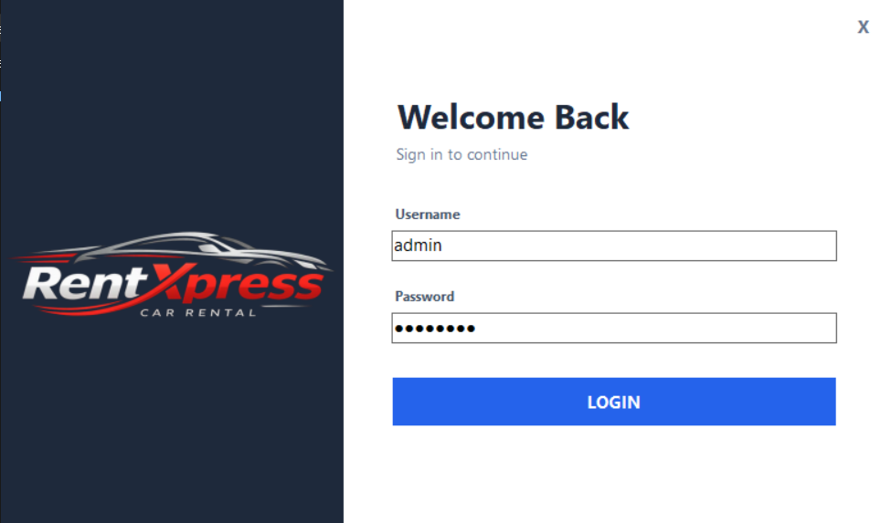
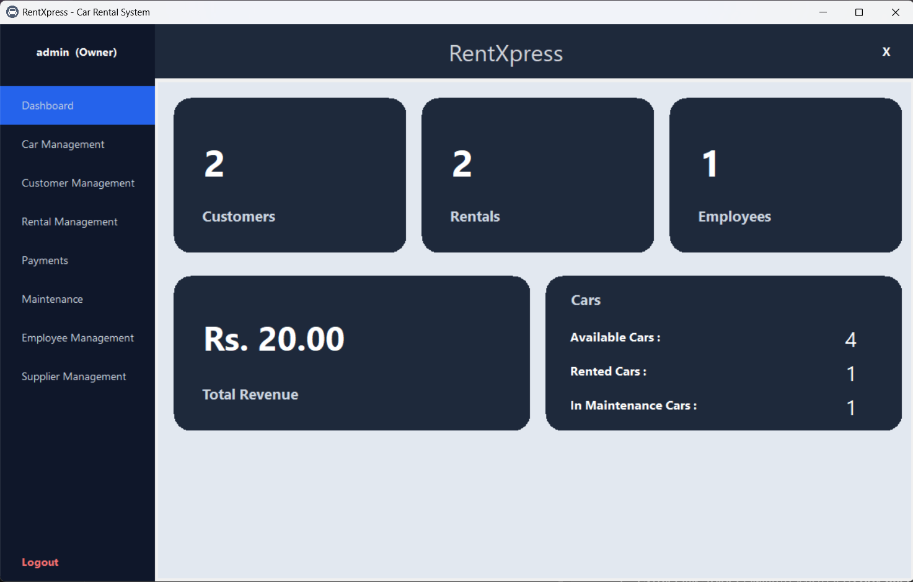
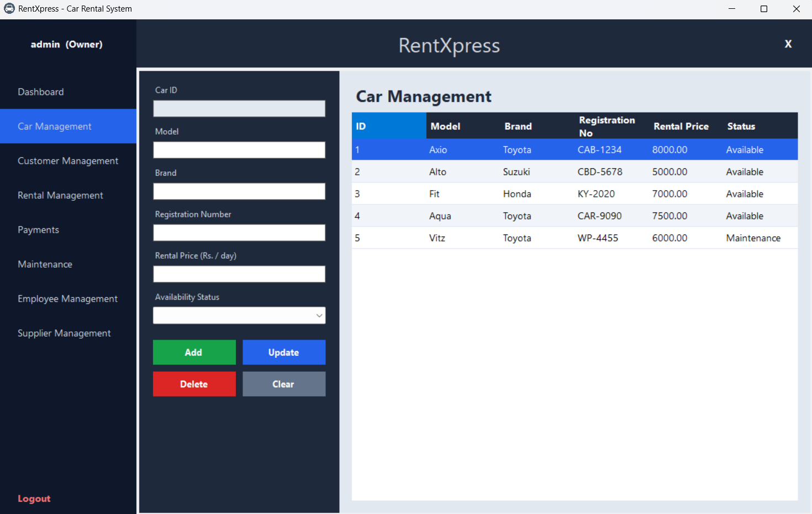
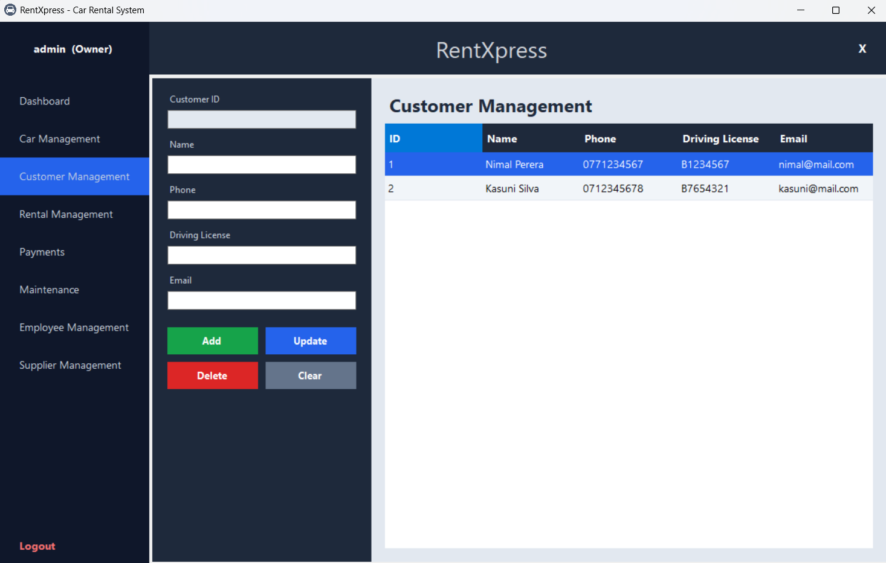
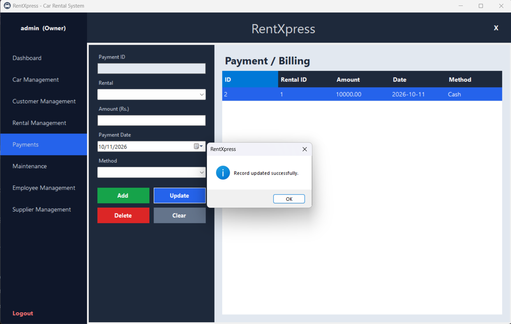
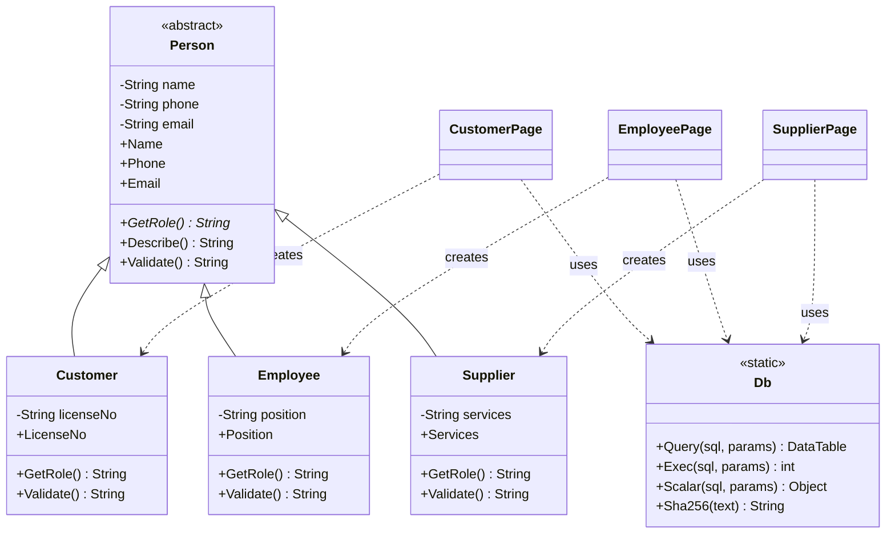
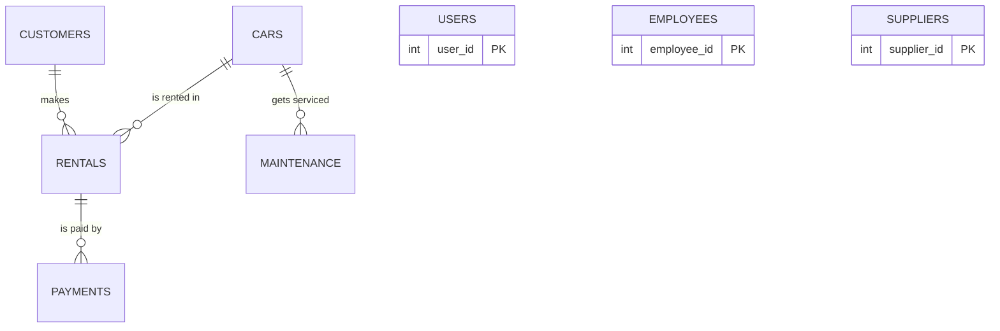

<div align="center">

# 🚗 RentXpress

### A desktop car rental management system

Manage cars, customers, rentals, payments, maintenance, employees and suppliers from one clean dark-themed dashboard.


**ICT 1306 – Object Oriented Programming · Group Assignment**
Department of Computing, Rajarata University of Sri Lanka

</div>

---

## 📸 Screenshots

<table>
  <tr>
    <td width="50%"><b>Login</b><br></td>
    <td width="50%"><b>Dashboard</b><br></td>
  </tr>
  <tr>
    <td width="50%"><b>Car Management</b><br></td>
    <td width="50%"><b>Customer Management</b><br></td>
  </tr>
  <tr>
    <td width="50%"><b>Payments / Billing</b><br></td>
    <td width="50%"></td>
  </tr>
</table>

## 🎥 Demo video

▶️ **[Watch the 5-minute demo on YouTube](https://youtube.com/REPLACE_WITH_YOUR_UNLISTED_LINK)**

## ✨ Features

| Module | What you can do |
|---|---|
| 🔐 **Login** | Secure sign-in (passwords stored as SHA-256 hashes) |
| 📊 **Dashboard** | Live totals: customers, rentals, employees, revenue, available / rented / in-maintenance cars |
| 🚙 **Car Management** | Add, update, delete and search cars (model, brand, registration number, daily price, status) |
| 👤 **Customer Management** | Customer profiles with phone, driving licence and email validation |
| 🔑 **Rental Management** | Link an existing car with an existing customer; total price is calculated automatically; only *Available* cars can be rented |
| 💳 **Payments** | Record payments against rentals; revenue feeds the dashboard |
| 🛠 **Maintenance** | Log service jobs; the car's status switches to *Maintenance* / *Available* automatically |
| 🧑‍💼 **Employee Management** | Register and manage staff (position, phone, email, hire date) |
| 🏭 **Supplier Management** | Manage suppliers and the services they provide |
| 🙍 **My Profile** | Change display name and password |

All seven record types support full **Add / View / Update / Delete** with live search, and every screen can be edited with the **Visual Studio Form Designer (drag & drop)**.

## 🧱 Object-Oriented Design

All six OOP concepts and the page classes.

| Concept | Where it is used |
|---|---|
| **Class** | `Person`, `Customer`, `Employee`, `Supplier`, `CarPage`, `MainForm` … |
| **Object** | `last = gcnew Customer(name, phone, email, license);` in `CustomerPage.h` · `gcnew MainForm()` in `Main.cpp` |
| **Encapsulation** | `Person` keeps `name`, `phone`, `email` **private**; access only through validated properties (`Name`, `Phone`, `Email`) |
| **Abstraction** | `Person` is an **abstract** class; `GetRole()` is a pure virtual method every subclass must implement |
| **Inheritance** | `Customer`, `Employee`, `Supplier` inherit from `Person`; every screen inherits from `UserControl` / `Form` |
| **Polymorphism** | `Validate()` and `Describe()` are overridden – `Customer` checks the licence, `Employee` the position, `Supplier` the services |

### Class diagram



### Database model



## 🛠 Tech stack

- **Language:** C++/CLI (CLR Empty Project, .NET Framework 4.8)
- **UI:** Windows Forms – built with the Visual Studio Designer
- **Database:** MySQL 8 via MySQL Connector/NET (`MySql.Data`)
- **IDE:** Visual Studio 2026

## 🚀 Getting started

### 1. Prerequisites
- Visual Studio 2026 with **Desktop development with C++** and the components **C++/CLI support** and **.NET Framework 4.8 SDK / targeting pack**
- MySQL Server 8 and MySQL Workbench
- MySQL Connector/NET (`MySql.Data.dll`)

### 2. Create the database
1. Open **MySQL Workbench** and connect as `root`.
2. **File → Open SQL Script…** → [`Doc/database.sql`](Doc/database.sql) → click ⚡ *Execute*.

### 3. Configure the project
1. Clone the repo:
   ```bash
   git clone https://github.com/<your-username>/RentXpress.git
   ```
2. Copy `MySql.Data.dll` (and the DLLs beside it) into [`RentXpress/libs/`](RentXpress/libs/README.md).
3. Open [`RentXpress/Db.h`](RentXpress/Db.h) and replace `YOUR_PASSWORD` with your MySQL root password.

### 4. Run
1. Open **`RentXpress.sln`**.
2. Select **Debug · x64** and press **Ctrl + F5**.

### Default login

| Username | Password |
|---|---|
| `admin` | `admin123` |

> ⚠️ Change the password from **My Profile** after the first login.

## 🗂 Project structure

```
RentXpress/
├── RentXpress.sln
├── database/
│   └── rentxpress.sql          # schema + sample data
├── docs/
│   └── screenshots/            # images used in this README
└── RentXpress/
    ├── Main.cpp                # entry point: Login → Main → Logout loop
    ├── Entities.h              # OOP model: Person, Customer, Employee, Supplier
    ├── Db.h                    # MySQL access (parameterised queries)
    ├── Theme.h                 # colours + UI helper functions
    ├── LoginForm.h / .resx     # screen 1 – login
    ├── MainForm.h  / .resx     # screen 2 – sidebar navigation shell
    ├── DashboardPage.h / .resx
    ├── CarPage.h       / .resx
    ├── CustomerPage.h  / .resx
    ├── RentalPage.h    / .resx
    ├── PaymentPage.h   / .resx
    ├── MaintenancePage.h / .resx
    ├── EmployeePage.h  / .resx
    ├── SupplierPage.h  / .resx
    ├── ProfilePage.h   / .resx
    └── libs/               # put MySql.Data.dll here
```

## 🔒 Security notes
- Passwords are stored as **SHA-256 hashes**, never as plain text.
- All SQL uses **parameterised queries** to prevent SQL injection.
- Never commit your real MySQL password – keep `YOUR_PASSWORD` in `Db.h` in the repository.

## 👥 Team

| Name | Index No. | Role |
|---|---|---|
| _Member 1_ | _XX/XXXX_ | _e.g. Database & Db class_ |
| _Member 2_ | _XX/XXXX_ | _e.g. Login & Main form_ |
| _Member 3_ | _XX/XXXX_ | _e.g. Car & Customer modules_ |
| _Member 4_ | _XX/XXXX_ | _e.g. Rental & Payment modules_ |
| _Member 5_ | _XX/XXXX_ | _e.g. Maintenance, Employee & Supplier modules_ |

## 📄 License

Released under the [MIT License](LICENSE).

---

<div align="center">
Made for <b>ICT 1306 – Object Oriented Programming</b> · Rajarata University of Sri Lanka
</div>
